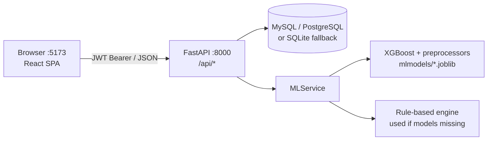

# MedEquip Operations & ML Platform

A full-stack hospital **medical-equipment management and predictive-maintenance** platform. Clinical staff log equipment telemetry, an ML engine (XGBoost, with a rule-based fallback) scores failure risk and recommends a fix category, and engineers and administrators run the full service, recall and spare-parts workflow.

| Layer | Stack |
| --- | --- |
| Frontend | React 19, Vite 8, React Router 7, Tailwind CSS (CDN), React Compiler |
| Backend | FastAPI, SQLAlchemy 2, Pydantic 2, JWT auth (python-jose + passlib/bcrypt) |
| Database | MySQL / PostgreSQL via `DATABASE_URL`, **auto-falls back to SQLite** (`backend/medequip.db`) |
| ML | XGBoost + scikit-learn preprocessors (joblib), PyTorch MLP weights, rule engine fallback |
| Tests | pytest + FastAPI `TestClient` |

---

## Repository layout

```
Cognizant Project/
├── README.md            ← you are here
├── USER_MANUAL.md       ← end-user guide: modules, workflows, screenshots of each portal
├── backend/             ← FastAPI REST API + ML inference       → see backend/README.md
│   ├── app/             (core, database, models, schemas, routers, services)
│   ├── mlmodels/        (trained .joblib / .pth artifacts)
│   ├── scripts/         (create_db, seed_database, import_dataset)
│   ├── tests/           (pytest suite)
│   └── run.py           (dev server entry point, port 8000)
└── frontend/            ← React + Vite single-page app (npm run dev → :5173)
    └── src/             (pages, components, contexts, assets)
```

---

## Architecture



**Core workflow**

1. A nurse/doctor enters a health reading (temperature, pressure, operating hours, downtime, battery voltage, flow rate, error code, notes).
2. The backend runs it through `MLService.predict_health()` and returns a risk score (0–100), a risk level (`LOW`/`MEDIUM`/`HIGH`/`CRITICAL`), contributing factors and a recommended fix category.
3. High-risk equipment is sent to the **Service Station** as a service request.
4. The request moves through its lifecycle:
   `RAISED → ACKNOWLEDGED → IN_DIAGNOSIS → IN_SERVICE → (WAITING_FOR_PARTS / SERVICE_DELAYED) → COMPLETED` (or `REJECTED`).
5. Completed work becomes service history, which feeds the admin dashboard, recalls and replacement decisions.

---

## Quick start

**Prerequisites:** Python 3.10–3.13, Node.js 18+.

### 1. Backend (terminal 1)

```powershell
cd backend
python -m venv venv
.\venv\Scripts\Activate.ps1          # macOS/Linux: source venv/bin/activate
pip install -r requirements.txt
python scripts/seed_database.py      # creates tables + demo users, equipment, requests, parts
python run.py                        # http://localhost:8000  (Swagger: /docs)
```

### 2. Frontend (terminal 2)

```powershell
cd frontend
npm install
npm run dev                          # http://localhost:5173
```

### 3. Log in

| Role | Email | Password |
| --- | --- | --- |
| Nurse / Doctor (`NURSE_DOCTOR`) | `nurse@medequip.com` | `NursePass123!` |
| Biomedical Engineer (`MAINTENANCE_ENGINEER`) | `engineer@medequip.com` | `EngPass123!` |
| Hospital Admin (`HOSPITAL_ADMIN`) | `admin@medequip.com` | `AdminPass123!` |

These are **demo credentials** created by the seed script. Don't use them anywhere real.

---

## Running the tests

```powershell
cd backend
pytest -v
```

The suite uses its own SQLite database (`test_medequip.db`) and covers auth, equipment CRUD, health prediction and the service-request workflow.

---

## Documentation index

| Document | For |
| --- | --- |
| [`USER_MANUAL.md`](USER_MANUAL.md) | End users and demos: what each module does and how to use it |
| [`backend/README.md`](backend/README.md) | API reference, configuration, data model, ML engine, scripts, tests |
---

## Known issues / housekeeping

- **Committed files that shouldn't be in git:** `backend/.env`, `backend/medequip.db`, `backend/test_medequip.db` and all `__pycache__/*.pyc`. Add a root `.gitignore` and `git rm --cached` them; keep only `.env.example`.
- **Default JWT secret:** `JWT_SECRET_KEY` has a hard-coded default in `backend/app/core/config.py`. Set a real secret in `.env` before deploying anywhere.
- **MySQL driver is missing:** the default `DATABASE_URL` uses `mysql+pymysql`, but `pymysql` isn't in `requirements.txt`, so the app silently uses SQLite. Run `pip install pymysql` if you want MySQL.
- **Engineer portal isn't wired up:** pages in `frontend/src/pages/engineer/` exist but aren't routed in `App.jsx`. Engineer accounts currently see the clinical view.
- **API URL is hard-coded:** the frontend calls `http://localhost:8000/api` directly (`AuthContext.jsx`, `EquipmentHealthAssessment.jsx`).
- `backend/app/ml_service.py` is an older copy; the live service is `backend/app/services/ml_service.py`.
