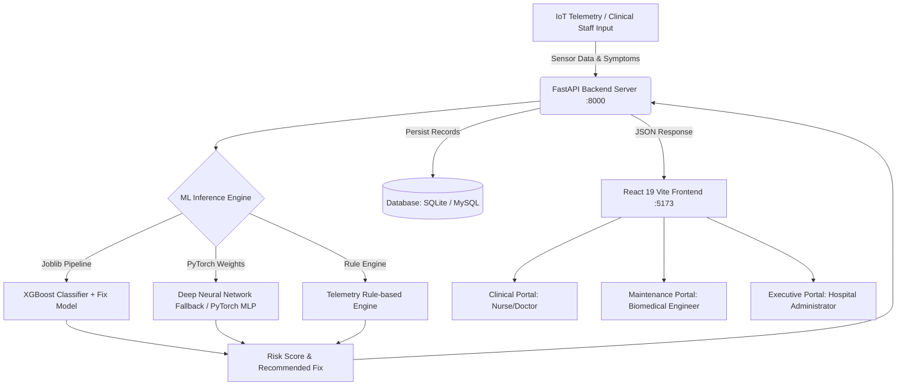

# 🏥 MedEquip Operations & ML Platform — User Manual & Technical Documentation

---

## 📌 1. Project Overview & Motto

### 🎯 **Project Motto**
> **"Zero Unplanned Downtime for Life-Critical Healthcare Assets."**  
> *Empowering clinical teams and biomedical engineers with intelligent, AI-driven predictive maintenance, real-time telemetry analytics, and proactive equipment lifecycle governance.*

### 🩺 **Executive Summary**
In modern healthcare facilities, medical equipment failure in critical environments (such as the ICU, Operating Rooms, Emergency Rooms, and Cardiology Suites) can directly threaten patient lives, delay essential surgeries, and create immense operational costs. 

The **MedEquip Operations & ML Platform** is an enterprise-grade, full-stack predictive maintenance and hospital asset management system. It bridges the communication and operational gap between **Clinical Staff (Nurses/Doctors)**, **Biomedical Engineers (Maintenance Technicians)**, and **Hospital Administrators**. By analyzing sensor telemetry (temperature, pressure, voltage, hours, error codes) using Machine Learning (XGBoost & PyTorch), the platform accurately forecasts machine failure risk before catastrophic breakdown occurs, recommends precise repair actions, tracks safety recalls, and automates maintenance work orders.

---

## 🏗️ 2. System Architecture & How It Works



### 🔄 **End-to-End Operational Workflow**
1. **Telemetry & Observation Logging**: Clinical staff or biomedical engineers log operational readings (temperature, system pressure, operating hours, downtime, battery voltage, flow rate, error codes, and clinical notes).
2. **AI/ML Health Diagnosis**: The FastAPI backend feeds preprocessed telemetry features through the machine learning pipeline (XGBoost Classifier and Fix Category Model).
3. **Risk Scoring & Fix Classification**: The system computes a failure probability risk percentage (0–100%), determines the risk status (*OPTIMAL*, *WARNING*, *CRITICAL*), and specifies the required repair category (e.g., *Thermal/Cooling*, *Battery*, *Calibration*, *Electrical Safety*, *Mechanical/PM*).
4. **Automated Dispatch to Service Station**: If a machine presents high failure risk or safety notices, it can be instantly dispatched to the **Service Station** with prioritized work orders and vendor dispatch.
5. **Maintenance & Safety Recall Management**: Engineers log repairs, parts used, delay reasons, and safety recall updates.
6. **Audit & Executive Governance**: Upon completion, full service logs, costs, and technician notes are archived into the immutable **Service History** and reflected in the **Administrator Dashboard** for compliance and asset lifecycle auditing.

---

## 💻 3. Technology Stack

### 🎨 **Frontend Architecture**
| Component | Technology | Version | Purpose |
| :--- | :--- | :--- | :--- |
| **Framework** | React | `^19.2.8` | High-performance reactive UI with modern hooks and concurrent rendering |
| **Build Tool & Bundler** | Vite | `^8.2.0` | Ultra-fast Hot Module Replacement (HMR) and production bundling |
| **Routing** | React Router DOM | `^7.18.2` | Client-side routing with role-based protected routes |
| **Styling & Design** | Tailwind CSS | Modern v3/v4 | Custom healthcare theme, design tokens, responsive grid layouts |
| **Icons & Typography** | Google Material Symbols & Plus Jakarta Sans | Web Fonts | Clean, modern clinical design iconography |
| **State Management** | React Context API | Native | Context providers for Authentication (`AuthContext`) & Assets (`EquipmentContext`) |

---

### ⚙️ **Backend Architecture**
| Component | Technology | Version | Purpose |
| :--- | :--- | :--- | :--- |
| **Web Framework** | FastAPI | `>=0.100.0` | Asynchronous, high-throughput REST API with automated OpenAPI / Swagger docs |
| **ASGI Web Server** | Uvicorn | `>=0.22.0` | Production ASGI web server with auto-reloading |
| **Data Validation** | Pydantic & Pydantic-Settings | `>=2.0.0` | Strict schema validation and typed application configuration |
| **ORM & Database Layer** | SQLAlchemy | `>=2.0.0` | Modern 2.0-style ORM mapping with relational model associations |
| **Database Engines** | SQLite & MySQL / PostgreSQL | Native / 8.0+ | Zero-config local SQLite with automatic fallback and MySQL pooling |
| **Migrations** | Alembic | `>=1.11.0` | Database schema migrations and revision management |
| **Authentication & Security**| Python-Jose, Passlib, BCrypt | Latest | JWT bearer tokens (HS256) and salted BCrypt password hashing |

---

### 🤖 **Machine Learning & Data Science Stack**
| Component | Technology | Purpose |
| :--- | :--- | :--- |
| **Gradient Boosting** | XGBoost (`xgboost>=1.7.0`) | Primary ML classification pipeline for machine failure probability |
| **Deep Learning** | PyTorch (`torch>=2.0.0`) | PyTorch Multi-Layer Perceptron (`pytorch_mlp_model.pth`) |
| **Data Preprocessing** | Scikit-Learn (`scikit-learn>=1.2.0`) | Column transformers, standard scalers, and label encoders |
| **Data Manipulation** | Pandas & NumPy | Tabular data manipulation and matrix operations |
| **Model Persistence** | Joblib (`joblib>=1.2.0`) | Serialized model pipelines (`xgb_model.joblib`, `preprocessor.joblib`) |

---

## 📦 4. Detailed Module Guide

### 🔐 **Module 1: Authentication & Role-Based Access Control (RBAC)**
* **Purpose**: Secures the platform and provides tailored user experiences tailored to healthcare personnel.
* **Key Capabilities**:
  * **JWT Authentication**: Encrypted JSON Web Token generation with configurable expiration (8 hours standard).
  * **Role Segregation**:
    * `NURSE_DOCTOR` (Clinical Staff): Focuses on daily equipment health, bed-side diagnostics, active ward status, and raising service requests.
    * `MAINTENANCE_ENGINEER` (Biomedical Technician): Manages repair work orders, parts inventory, delayed service logs, and maintenance activities.
    * `HOSPITAL_ADMIN` (Hospital Management): High-level fleet KPIs, department readiness, financial impact, recall governance, and compliance.
  * **Protected Route Guards**: Automatically directs users to their respective portals and enforces endpoint security.

---

### 🩺 **Module 2: Clinical Dashboard**
* **Target Users**: Nurses, Critical Care Physicians, Clinical Unit Managers.
* **Key Features**:
  * **Category Health Cards**: Real-time breakdown of Ventilators, Patient Monitors, Defibrillators, Infusion Pumps, and Imaging Systems.
  * **Fleet Readiness Counters**: Instant metrics showing Active Available units, Devices in Maintenance, and Emergency Backup readiness.
  * **Quick Diagnostic Action**: One-click transition into the Equipment Health Assessment module.
  * **Active Work Orders Feed**: Real-time display of high-priority tickets, repair status, and estimated delivery dates.

---

### 🧠 **Module 3: Equipment Health Assessment (AI/ML Diagnostic Engine)**
* **Target Users**: Clinical Staff & Biomedical Engineers.
* **Key Features**:
  * **Multi-Parameter Telemetry Input**:
    * Operating Temperature (°C)
    * System Pressure (cmH2O)
    * Total Operating Hours & Recent Downtime
    * Backup Battery Voltage (V)
    * Flow Rate (L/min)
    * System Diagnostic Error Codes (e.g., `ERR-042-T`, `ERR-BAT-102`)
    * Clinical Observation & Anomaly Notes (with NLP abnormality keyword detection)
  * **Instant ML Risk Scoring**: Runs live inference via the FastAPI `/api/predict` endpoint, outputting Failure Probability (0-100%) and Health Index.
  * **Prescriptive Maintenance Advice**: Predicts the exact required fix action (e.g., *Thermal/Cooling*, *Battery*, *Airway Calibration*, *Mechanical Overhaul*).
  * **One-Click Dispatch**: Ability to immediately convert a flagged health assessment into a prioritized **Service Station Work Order**.

---

### 🛠️ **Module 4: Service Station & Maintenance Dispatch**
* **Target Users**: Biomedical Engineers & Ward Supervisors.
* **Key Features**:
  * **Active Maintenance Pipeline**: Tracks machines currently sent for servicing, repairs, or recall fixes.
  * **Service Lifecycle Actions**:
    * **Mark Complete**: Resolves the work order, records technician notes, and automatically restores the machine to `Active / Available` in the hospital fleet.
    * **Mark Delayed / Overdue**: Extends expected delivery date with logged reasons (e.g., "Awaiting OEM parts").
    * **Escalate to Recall**: Converts standard service into a Class I/II Manufacturer Safety Recall.
  * **Financial & Vendor Tracking**: Monitors authorized service vendors (e.g., Philips Healthcare, Mindray Global, Siemens Healthineers) and estimated costs.

---

### 📋 **Module 5: Hospital Equipment Fleet Inventory**
* **Target Users**: Clinical Staff, Department Heads, Inventory Managers.
* **Key Features**:
  * **Comprehensive Asset Registry**: Tracks Machine ID, Model, Serial Number, Department, Physical Location (e.g., *ICU Bed 04*, *OR-Hybrid Suite*), Status, and Warranty info.
  * **Category & Department Filtering**: Fast search by asset ID, manufacturer, or equipment type.
  * **Add New Equipment Modal**: Modal form to register new hospital assets directly into the database with instant UI updates.
  * **Asset Decommissioning**: Secure deletion and decommissioning of retiring assets.
  * **Backup Availability Indicator**: Visual badges showing if a backup device is ready on standby.

---

### 📜 **Module 6: Service History & Audit Log**
* **Target Users**: Biomedical Engineers, Auditors, Compliance Officers.
* **Key Features**:
  * **Historical Work Order Archive**: Permanent ledger of all completed and ongoing maintenance activities.
  * **Cost & Technician Logging**: Records historical expenditures, repair dates, technician assignments, and diagnostic notes.
  * **Audit-Ready Export**: Formatted record details for hospital accreditation (JCI, NABH, ISO 13485).

---

### 📊 **Module 7: Administrator Executive Dashboard**
* **Target Users**: Chief Medical Officers, Hospital Administrators, Operations Directors.
* **Key Features**:
  * **Executive KPI Suite**: Total Fleet Count, Operational Readiness Percentage, Total Active Recalls, and Completed Work Orders.
  * **Departmental Fleet Distribution**: Detailed operational breakdown across ICU, Emergency (ER), Surgery, Radiology, and Cardiology.
  * **Asset Health Distribution**: Live visibility into equipment aging, critical risk clusters, and upcoming preventative maintenance schedules.

---

### ⚠️ **Module 8: Recall & Regulatory Safety Monitoring**
* **Target Users**: Hospital Risk Managers, Compliance Officers, Lead Engineers.
* **Key Features**:
  * **FDA / OEM Safety Recall Tracking**: Monitors active safety notices, affected serial numbers, and mandatory firmware/hardware upgrades.
  * **Risk Mitigation Status**: Tracks remediation progress from *Initial Notice* to *Safety Clearance*.
  * **Zero-Cost Warranty Processing**: Automatically tags recall work orders under manufacturer warranty obligations.

---

### ⚙️ **Module 9: Spare Parts & Resource Management**
* **Target Users**: Biomedical Engineers & Supply Chain Managers.
* **Key Features**:
  * **Critical Spare Parts Catalog**: Stock tracking for HEPA filter assemblies, Li-ion battery packs, pressure transducers, and cooling fans.
  * **Reorder Threshold Alerts**: Identifies low-stock components to prevent maintenance delays.

---

## 👥 5. User Roles & Pre-Seeded Credentials

The platform comes pre-configured with test persona accounts ready for instant demonstration:

| Role | Name | Email | Password | Primary Portal |
| :--- | :--- | :--- | :--- | :--- |
| **Clinical Staff (Nurse/Doctor)** | Dr. Priya | `nurse@medequip.com` | `NursePass123!` | Clinical Dashboard, Health Entry, Inventory |
| **Biomedical Engineer** | J. Miller | `engineer@medequip.com` | `EngPass123!` | Service Station, Work Orders, Parts |
| **Hospital Administrator** | Dr. Sarah Chen | `admin@medequip.com` | `AdminPass123!` | Executive Dashboard, Recalls, Audits |

---

## 🚀 6. Step-by-Step Guide: How to Run the Project

### 📋 **Prerequisites**
- **Node.js**: v18.0.0 or higher
- **Python**: v3.10 to v3.13
- **Git** (optional, for version control)

---

### 🔹 **Step 1: Backend Setup (FastAPI + ML Engine)**

1. Open a terminal and navigate to the `backend` folder:
   ```bash
   cd "D:\Cognizant Project\backend"
   ```

2. *(Recommended)* Create and activate a Python virtual environment:
   ```bash
   python -m venv venv
   # On Windows (PowerShell):
   .\venv\Scripts\Activate.ps1
   # On Windows (Command Prompt):
   .\venv\Scripts\activate.bat
   ```

3. Install required Python packages:
   ```bash
   pip install -r requirements.txt
   ```

4. Initialize database tables and seed test accounts & equipment:
   ```bash
   python scripts/seed_database.py
   ```
   *(This automatically creates `medequip.db` and populates the 3 user personas, 11 medical machines, sample health readings, service requests, and spare parts).*

5. Start the FastAPI backend server:
   ```bash
   python run.py
   ```
   *The backend will start at:* **`http://localhost:8000`**  
   *Interactive API Docs (Swagger UI) available at:* **`http://localhost:8000/docs`**

---

### 🔹 **Step 2: Frontend Setup (React 19 + Vite)**

1. Open a new terminal and navigate to the `frontend` directory:
   ```bash
   cd "D:\Cognizant Project\frontend"
   ```

2. Install npm dependencies:
   ```bash
   npm install
   ```

3. Launch the Vite development server:
   ```bash
   npm run dev
   ```
   *The frontend application will start at:* **`http://localhost:5173`**

---

### 🔹 **Step 3: Accessing and Testing the Application**

1. Open your browser and navigate to **`http://localhost:5173`**.
2. Log in using any of the pre-seeded accounts:
   - For **Clinical & ML Health Entry**: Log in with `nurse@medequip.com` / `NursePass123!`.
   - For **Hospital Administration**: Log in with `admin@medequip.com` / `AdminPass123!`.
3. Try performing an AI Health Assessment:
   - Go to **Equipment Health Entry**.
   - Select a machine (e.g., *Respironics V60 Ventilator*).
   - Enter sensor values (e.g., Temperature `41.5`, Error Code `ERR-042-T`).
   - Click **Run Diagnostic Assessment** to see the real-time ML risk output and recommended fix!
   - Click **Send to Service Station** to dispatch the equipment.

---

## 📡 7. API Endpoints Reference

The backend provides complete RESTful endpoints documented interactively at `/docs`:

| HTTP Method | Endpoint | Description |
| :--- | :--- | :--- |
| `POST` | `/api/auth/login` | Authenticates user and returns JWT bearer token |
| `POST` | `/api/auth/register` | Registers a new user account |
| `GET` | `/api/auth/me` | Fetches the authenticated user profile |
| `POST` | `/api/predict` | ML Telemetry Health Prediction (Risk score & recommended fix) |
| `GET` | `/api/equipment` | Lists hospital equipment with pagination & filters |
| `POST` | `/api/equipment` | Registers a new piece of medical equipment |
| `DELETE` | `/api/equipment/{id}` | Decommissions/removes an equipment asset |
| `GET` | `/api/service-requests` | Retrieves active maintenance service requests |
| `POST` | `/api/service-requests` | Creates a new maintenance work order |
| `GET` | `/api/spare-parts` | Lists spare parts inventory and stock levels |
| `GET` | `/api/recalls` | Lists active manufacturer safety recalls |
| `GET` | `/api/dashboard/clinical` | Summary statistics for clinical dashboard |
| `GET` | `/api/dashboard/admin` | Summary metrics and KPI cards for admin portal |

---

## ❓ 8. FAQ & Troubleshooting

### Q1: What happens if MySQL is not installed or offline?
> **Answer**: The backend includes an automated database fallback mechanism in [`app/database/session.py`](file:///D:/Cognizant%20Project/backend/app/database/session.py). If a MySQL or PostgreSQL server is not detected on `localhost:3306`, it automatically and seamlessly falls back to a local SQLite database (`medequip.db`). No additional database installation is required for testing.

### Q2: How do the ML models work if joblib files are missing?
> **Answer**: The ML service in [`app/services/ml_service.py`](file:///D:/Cognizant%20Project/backend/app/services/ml_service.py) automatically validates the existence of the trained artifacts (`xgb_model.joblib`, `preprocessor.joblib`). If ML artifacts are temporarily unavailable, it automatically switches to the built-in clinical rule engine fallback, ensuring 100% platform uptime.

### Q3: How do I add or import large datasets?
> **Answer**: You can import Excel (`.xlsx`) or CSV datasets of medical equipment and telemetry history by running:
> ```bash
> python scripts/import_dataset.py --file path/to/your_dataset.xlsx
> ```

---

## 📜 9. License & Project Credits
* **Project**: MedEquip Operations & ML Platform
* **Purpose**: Healthcare Asset Management & Predictive Failure Diagnostics
* **Version**: 2.0.0 Production Edition
